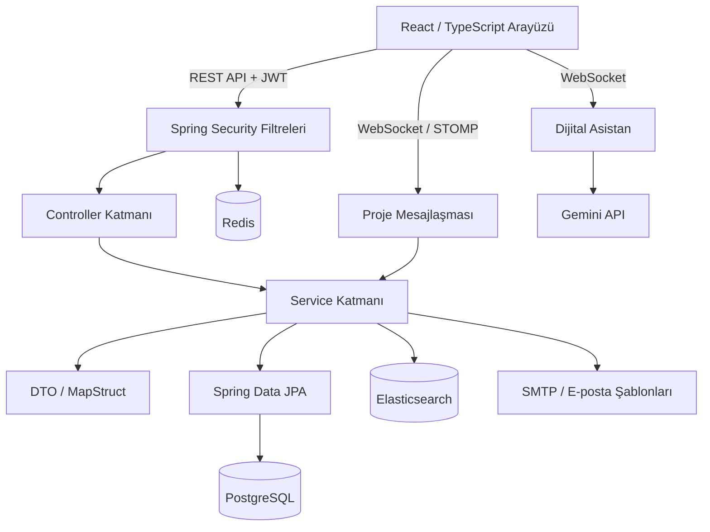

# Eclipse / SpaceNet — Uzay Sanayisi İş Birliği Platformu

Spring Boot ve React tabanlı; firmaları ve tedarikçileri kurum profilleri, teknik yetkinlikler ve proje ihtiyaçları üzerinden bir araya getiren tam kapsamlı bir web uygulaması.

Hackathon kapsamında geliştirilen bu proje; REST API tasarımı, katmanlı backend mimarisi, rol bazlı yetkilendirme, arama ve eşleştirme, gerçek zamanlı iletişim ve etkileşimli arayüz geliştirme çalışmalarını tek bir depoda sunar. Kaynak kod incelemesi ve portföy gösterimi amacıyla paylaşılmaktadır; canlıya alma planı bulunmamaktadır.

---

## Proje Genel Bakış

Uzay ve havacılık ekosistemindeki firmaların ihtiyaç duyduğu teknik yetkinlikleri bulması, uygun tedarikçileri keşfetmesi ve proje bazlı iş birliği kurması hedeflenmiştir.

Sistemde firma bir proje ilanı açar; ihtiyaç duyduğu yetkinlikleri, tercih ettiği tedarikçi kategorisini, lokasyonunu ve sertifika beklentilerini belirtir. Tedarikçi ise kurum profilini, uzmanlık alanlarını ve teknik kapasitesini tanımlar. Platform bu bilgiler üzerinden eşleşme puanları ve öneri gerekçeleri üretir; başvuru, davet ve mesajlaşma süreçlerini destekler.

### Kullanıcı Rolleri

| Rol | Sistemdeki Sorumluluğu |
| :--- | :--- |
| `FIRMA` | Kurum profilini yönetir, proje ilanı oluşturur, tedarikçi arar, başvuruları değerlendirir ve davet gönderir. |
| `TEDARIKCI` | Teknik yetkinliklerini tanımlar, uygun projeleri keşfeder, başvuru yapar ve gelen davetlere yanıt verir. |
| `ADMIN` | Kullanıcı onaylarını, hesap rollerini ve yetkinlik kayıtlarını yönetir. |

---

## Temel Özellikler

### 1. Kimlik Doğrulama ve Hesap Yönetimi

- Firma ve tedarikçi için ayrı kayıt akışları
- JWT ile giriş, token yenileme ve çıkış işlemleri
- Access, refresh ve CSRF tokenlarının kullanım amacına göre ayrılması
- BCrypt ile parola özetleme
- Başarısız giriş denemelerinin sınırlandırılması
- E-posta üzerinden parola sıfırlama
- Yönetici tarafından hesap onaylama ve rol güncelleme

### 2. Kurum Profilleri ve Yetkinlikler

- Kullanıcı hesabından ayrı `Organization` veri modeli
- Firma ve tedarikçi için aşamalı profil tamamlama (onboarding)
- Faaliyet alanı, lokasyon, web sitesi ve iletişim bilgileri
- Donanım, yazılım, Ar-Ge ve hizmet yetkinlikleri
- Sertifikalar, referans projeler ve teknik altyapı bilgileri
- Profil tamamlama oranı ve görünürlük ayarları
- Yönetici tarafından yetkinlik ekleme, güncelleme ve silme

### 3. Proje, Başvuru ve Davet Yönetimi

- Proje ilanı oluşturma, güncelleme ve kapatma
- Gerekli yetkinlikler, bütçe aralığı, süre ve son başvuru tarihi tanımlama
- Tedarikçinin projeye başvurması ve başvurusunu geri çekmesi
- Firmanın gelen başvuruları değerlendirmesi ve durumlarını güncellemesi
- Firmadan tedarikçiye proje daveti gönderilmesi
- Tedarikçinin daveti kabul etmesi veya reddetmesi

### 4. Keşif ve Eşleştirme

- Tedarikçi arama ve filtreleme
- Proje için uygun tedarikçilerin listelenmesi
- Tedarikçiye uygun aktif projelerin önerilmesi
- Eşleşme puanına eşlik eden açıklanabilir öneri gerekçeleri
- Elasticsearch üzerinde kurum profillerinin indekslenmesi
- Arama indeksi okunamadığında veya boş olduğunda veritabanına dönüş akışı

### 5. Gerçek Zamanlı İletişim ve Dijital Asistan

- WebSocket / STOMP üzerinden proje bazlı mesajlaşma
- Mesaj geçmişi ve okunmamış mesaj sayısı için REST API
- Proje sohbetine abonelik sırasında erişim kontrolü
- Ayrı WebSocket bağlantısı üzerinden Gemini destekli asistan
- Oturum bazlı, sınırlı uzunlukta asistan konuşma geçmişi
- SMTP ve e-posta şablonları ile bildirim akışları

### 6. Kullanıcı Arayüzü

- React ve TypeScript ile sayfa ve bileşen yapısı
- Firma, tedarikçi ve yönetici panelleri
- Kurum ve proje keşif sayfaları
- Profil, başvuru ve proje yönetim ekranları
- Tema yönetimi ve uygulama içi bildirimler
- Three.js ve React Three Fiber ile etkileşimli uzay sahneleri

---

## Kullanılan Teknolojiler

| Katman | Teknolojiler |
| :--- | :--- |
| Backend | Java 21, Spring Boot 4.1, Spring Web MVC |
| Güvenlik | Spring Security, JWT / JJWT, BCrypt, Bean Validation |
| Veri Erişimi | Spring Data JPA, Hibernate, PostgreSQL |
| Arama ve Yardımcı Servisler | Elasticsearch, Redis |
| Veri Dönüşümü | MapStruct, Jackson |
| İletişim ve Entegrasyon | WebSocket, STOMP, SockJS, Gemini API, SMTP, Thymeleaf |
| Frontend | React 19, TypeScript, Vite, React Router, Axios |
| Görselleştirme | Three.js, React Three Fiber, React Three Drei |
| Derleme ve Kontroller | Maven Wrapper, npm, JUnit, Mockito, ESLint, GitHub Actions |
| Yerel Altyapı | Docker Compose |

---

## Proje Dosya Mimarisi ve Klasör Yapısı

Backend ve frontend aynı depo altında, birbirinden bağımsız çalıştırılabilir iki uygulama olarak düzenlenmiştir. Backend tarafında sorumluluklar controller, service, repository ve DTO katmanlarına ayrılır.

```text
.
├── backend/                              # Spring Boot API
│   ├── .mvn/                             # Maven Wrapper yapılandırması
│   ├── src/
│   │   ├── main/
│   │   │   ├── java/org/dev/eclipse/
│   │   │   │   ├── annotation/            # Audit gibi özel anotasyonlar
│   │   │   │   ├── aspect/                # İşlem kayıtlarına yönelik AOP katmanı
│   │   │   │   ├── config/                # Güvenlik, WebSocket ve servis ayarları
│   │   │   │   ├── controller/            # REST API uç noktaları
│   │   │   │   ├── dto/                   # İstek, yanıt ve MapStruct mapper modelleri
│   │   │   │   ├── elasticsearch/         # Arama belgeleri ve indeks repository'leri
│   │   │   │   ├── entity/                # JPA varlıkları ve ilişkileri
│   │   │   │   ├── enumarate/             # Rol ve iş akışı enumları
│   │   │   │   ├── exception/             # Özel hatalar ve merkezi hata yönetimi
│   │   │   │   ├── ratelimit/             # İstek sınırlandırma filtresi
│   │   │   │   ├── repository/            # Veritabanı erişimi
│   │   │   │   ├── scheduler/             # Zamanlanmış bakım işlemleri
│   │   │   │   ├── security/              # JWT ve erişim filtreleri
│   │   │   │   ├── service/               # Servis arayüzleri ve iş mantığı
│   │   │   │   ├── util/                  # Yardımcı araçlar
│   │   │   │   ├── validation/            # Özel doğrulama kuralları
│   │   │   │   └── websocket/             # Asistan ve STOMP mesajlaşma bileşenleri
│   │   │   └── resources/
│   │   │       ├── application*.yml       # Ortam değişkenleriyle uygulama ayarları
│   │   │       ├── templates/email/       # E-posta şablonları
│   │   │       └── public/                # Statik kaynaklar ve hata sayfası
│   │   └── test/                         # Test sınıfları ve test ayarları
│   ├── .env.example                      # Değersiz / boş gizli ayar örnekleri
│   ├── mvnw                              # Maven Wrapper
│   └── pom.xml                           # Bağımlılıklar ve derleme tanımları
├── frontend/                             # React arayüzü
│   ├── public/                           # İkonlar ve 3B model dosyaları
│   ├── src/
│   │   ├── components/                   # Ortak bileşenler, yerleşimler ve sahneler
│   │   ├── context/                      # Kimlik, veri, tema ve bildirim context'leri
│   │   ├── pages/                        # Sayfalar ve yönetim panelleri
│   │   ├── services/                     # Backend API istemcileri
│   │   ├── types/                        # TypeScript veri tipleri
│   │   └── utils/                        # Eşleştirme ve biçimlendirme yardımcıları
│   ├── .env.example                      # Yerel API ve WebSocket adresleri
│   └── package.json                      # Frontend bağımlılıkları ve komutları
├── scripts/check_secrets.py              # Kaynak dosyalarda gizli bilgi taraması
├── .github/workflows/ci.yml              # Otomatik doğrulama akışı
├── .env.example                          # Yerel Docker Compose ayar örneği
├── docker-compose.yml                    # PostgreSQL, Redis ve Elasticsearch
├── SECURITY.md                           # Güvenlik temizliği ve kontrol kapsamı
└── README.md                             # Ana proje dokümanı
```

---

## Sistem Mimarisi



### Katmanların Sorumlulukları

| Katman | Sorumluluk |
| :--- | :--- |
| Controller | İstekleri karşılar, giriş verisini doğrular ve yanıt modellerini döner. |
| Service | Rol, kurum sahipliği, başvuru ve iş akışı kurallarını uygular. |
| Repository | Kalıcı verileri Spring Data JPA üzerinden okur ve yazar. |
| DTO / Mapper | API modelleri ile veritabanı varlıkları arasında dönüşüm sağlar. |
| Security | Kimlik doğrulama, token kontrolleri ve erişim filtrelerini yürütür. |
| Elasticsearch | Kurumların arama belgelerini ve indeks işlemlerini yönetir. |
| WebSocket | Gerçek zamanlı mesajlaşma ve asistan iletişimini sağlar. |

### Temel Veri Modeli

`User` kimlik ve hesap bilgilerini, `Organization` kurum profilini tutar. `Project` firma tarafından yayımlanan ihtiyacı; `Capability` teknik yetkinliği temsil eder. `Application` tedarikçinin başvurusunu, `Invitation` firmanın davetini, `ChatMessage` ise proje sohbetindeki mesajı kaydeder.

---

## Eşleştirme Mantığı

Eşleştirme servisinde yetkinlik, sertifika, tedarikçi kategorisi ve lokasyon bilgileri değerlendirilir. Sonuçlarda hem sayısal puan hem de eşleşmenin gerekçeleri döndürülür; örneğin **“Yetkinlik uyumu”**, **“Sertifika uyumu”** veya **“Lokasyon uyumu”**.

Bu bölümdeki öneriler, kodda tanımlanan kurallara ve metin karşılaştırmalarına dayanır. Gemini entegrasyonu ayrı bir dijital asistan modülüdür.

### Örnek İş Birliği Akışı

1. Firma hesabı oluşturulur, yönetici onayı ve kurum profili tamamlanır.
2. Firma, teknik gereksinimlerini içeren bir proje ilanı yayımlar.
3. Tedarikçi, uzmanlıklarını ve sertifikalarını kurum profiline ekler.
4. Keşif ekranlarında uygun proje ve tedarikçi eşleşmeleri incelenir.
5. Tedarikçi başvurur veya firma davet gönderir.
6. Başvuru değerlendirilir; yetkili kullanıcılar proje sohbeti üzerinden iletişim kurar.

---

## API Uç Noktaları

Aşağıdaki tablolar temel API akışlarını gösterir. Kimlik doğrulama ve profil işlemlerinin ayrıntılı şemaları yerel Swagger arayüzünden incelenebilir.

### 1. Kimlik Doğrulama — `/api/v1/auth`

| Uç Nokta | Metot | Açıklama |
| :--- | :--- | :--- |
| `/register` | POST | Firma hesabı oluşturur. |
| `/register/supplier` | POST | Tedarikçi hesabı oluşturur. |
| `/login` | POST | Giriş yapar ve access token üretir. |
| `/refresh-token` | POST | Refresh ve CSRF kontrolleriyle access token yeniler. |
| `/forgot-password` | POST | Parola sıfırlama kodu gönderir. |
| `/reset-password` | POST | Sıfırlama koduyla parolayı değiştirir. |
| `/logout` | POST | Tokenları geçersizleştirir ve ilgili çerezleri temizler. |

### 2. Profil ve Yetkinlik Yönetimi

| Uç Nokta | Metot | Açıklama |
| :--- | :--- | :--- |
| `/api/v1/user/profile` | GET | Giriş yapan kullanıcının kurum profilini getirir. |
| `/api/v1/user/profile/firm` | PUT | Firma profilini günceller. |
| `/api/v1/user/profile/supplier` | PUT | Tedarikçi profilini günceller. |
| `/api/v1/user/onboarding` | GET | Profil tamamlama durumunu getirir. |
| `/api/v1/capabilities` | GET | Aktif yetkinlikleri listeler. |
| `/api/v1/capabilities` | POST | Yönetici için yetkinlik oluşturur. |
| `/api/v1/capabilities/{capabilityId}` | PUT / DELETE | Yönetici için yetkinliği günceller veya siler. |

### 3. Proje ve Keşif Yönetimi

| Uç Nokta | Metot | Açıklama |
| :--- | :--- | :--- |
| `/api/v1/projects` | POST | Proje ilanı oluşturur. |
| `/api/v1/projects/{projectId}` | GET / PUT | Proje detayını getirir veya ilanı günceller. |
| `/api/v1/projects/{projectId}/close` | PATCH | Proje ilanını kapatır. |
| `/api/v1/projects/my` | GET | Firmanın kendi ilanlarını getirir. |
| `/api/v1/projects/active` | GET | Aktif ilanları listeler. |
| `/api/v1/discovery/suppliers` | GET | Tedarikçi araması yapar. |
| `/api/v1/discovery/projects/{projectId}/supplier-matches` | GET | Projeye uygun tedarikçileri getirir. |
| `/api/v1/discovery/me/matching-projects` | GET | Tedarikçiye uygun projeleri getirir. |

### 4. Başvuru, Davet ve Mesajlaşma

| Uç Nokta | Metot | Açıklama |
| :--- | :--- | :--- |
| `/api/v1/applications/projects/{projectId}` | POST | Projeye başvuru yapar. |
| `/api/v1/applications/my` | GET | Tedarikçinin başvurularını listeler. |
| `/api/v1/applications/projects/{projectId}` | GET | Projeye gelen başvuruları getirir. |
| `/api/v1/applications/{applicationId}/status` | PATCH | Başvuru durumunu günceller. |
| `/api/v1/applications/{applicationId}/withdraw` | PATCH | Başvuruyu geri çeker. |
| `/api/v1/invitations/projects/{projectId}` | POST | Tedarikçiye davet gönderir. |
| `/api/v1/invitations/my` | GET | Gelen davetleri listeler. |
| `/api/v1/invitations/{invitationId}/respond` | PATCH | Daveti kabul eder veya reddeder. |
| `/api/v1/chat/projects/{projectId}/messages` | GET | Mesaj geçmişini sayfalı getirir. |
| `/api/v1/chat/projects/{projectId}/unread-count` | GET | Okunmamış mesaj sayısını getirir. |

**WebSocket bağlantıları:** `/ws/messaging` proje mesajlaşmasını, `/ws/chatbot` dijital asistanı sağlar. STOMP mesajları `/app/chat.sendCompany` ve `/app/chat.sendSupplier` hedeflerine gönderilir; yetkili kullanıcılar `/topic/projects/{projectId}/chat` kanalına abone olabilir.

---

## Güvenlik ve Yapılandırma

- Parolalar BCrypt ile özetlenir; gizli ayarlar ortam değişkenlerinden okunur.
- API erişiminde access token türü ve hesabın aktifliği kontrol edilir.
- Refresh akışında token türü, CSRF ve token kara listesi kontrolleri uygulanır.
- CORS ve WebSocket origin ayarları yapılandırılan frontend adresiyle sınırlandırılır.
- Giriş ve belirli API işlemlerinde istek sınırlandırma bulunur.
- Proje sohbetine abonelikte proje erişimi doğrulanır.
- Dosya erişiminde kimlik doğrulama ve dizin dışına çıkma kontrolleri uygulanır.

---

## Projeyi Yerel Ortamda Çalıştırma

### Gereksinimler

- JDK 21 ve Maven veya depodaki Maven Wrapper
- Node.js 22.12+; Node.js 24 önerilir
- Docker ve Docker Compose
- Gizli bilgi kontrolünü çalıştırmak için Python 3

### 1. Depoyu İndirin

```bash
git clone https://github.com/aydog4nn/eclipse-spacenet.git
cd eclipse-spacenet
```

### 2. Ortam Dosyalarını Hazırlayın

```bash
cp .env.example .env
cp backend/.env.example backend/.env
cp frontend/.env.example frontend/.env
```

Kök dizindeki `.env` ile `backend/.env` dosyalarında `DB_USERNAME` ve `DB_PASSWORD` değerlerini aynı olacak şekilde yapılandırın. Backend için yerel JWT anahtarını oluşturun:

```bash
openssl rand -base64 32
```

Üretilen değeri yalnızca `backend/.env` içindeki `JWT_SECRET_KEY` alanına ekleyin.

| Değişken | Kullanım |
| :--- | :--- |
| `DB_URL`, `DB_USERNAME`, `DB_PASSWORD` | PostgreSQL bağlantısı |
| `JWT_SECRET_KEY` | JWT imzalama anahtarı |
| `FRONTEND_URL` | İzin verilen frontend origin adresi |
| `GEMINI_API_KEY` | İsteğe bağlı dijital asistan entegrasyonu |
| `MAIL_USERNAME`, `MAIL_PASSWORD` | E-posta gönderimi için SMTP hesabı |
| `CONTACT_INBOX_EMAIL` | İletişim mesajlarının alıcı adresi |
| `BOOTSTRAP_ADMIN_*` | İlk yönetici hesabının isteğe bağlı oluşturulması |
| `VITE_API_BASE_URL` | Frontend'in kullandığı API adresi |
| `VITE_CHATBOT_WS_URL` | Frontend'in kullandığı asistan WebSocket adresi |

Gemini ve SMTP modüllerini denemek için kendi hesabınıza ait yerel ayarlar gerekir. `VITE_*` değişkenleri tarayıcıya gönderildiğinden bu alanlarda yalnızca bağlantı adresleri tutulmalıdır.

### 3. Yerel Servisleri Başlatın

Proje kök dizininde:

```bash
docker compose up -d
```

Bu komut PostgreSQL, Redis ve Elasticsearch servislerini başlatır. Backend ve frontend aşağıdaki adımlarda ayrıca çalıştırılır.

### 4. Backend'i Başlatın

```bash
cd backend
./mvnw spring-boot:run
```

Maven Wrapper yerine sistemdeki Maven ile `mvn spring-boot:run` da kullanılabilir. Windows için wrapper komutu `mvnw.cmd spring-boot:run` şeklindedir.

### 5. Frontend'i Başlatın

Ayrı bir terminalde, proje kök dizininden:

```bash
cd frontend
npm ci
npm run dev
```

| Servis | Yerel Adres |
| :--- | :--- |
| Kullanıcı arayüzü | `http://localhost:5173` |
| REST API | `http://localhost:8080/api/v1` |
| Swagger UI — geliştirme profili | `http://localhost:8080/swagger-ui.html` |

**İlk yönetici hesabı:** `backend/.env` dosyasında `BOOTSTRAP_ADMIN_ENABLED=true` yapıp yönetici e-posta, parola, ad ve soyad alanlarını doldurarak uygulamayı başlatabilirsiniz. Hesap oluşturulduktan sonra bootstrap ayarını kapatın. Yeni firma ve tedarikçi hesaplarının kullanılabilmesi için yönetici onayı gerekir.

---

## Test ve Otomatik Kontroller

### Gizli Bilgi Taraması

Proje kök dizininde:

```bash
python3 scripts/check_secrets.py
```

### Backend Güvenlik Testleri

```bash
cd backend
./mvnw test -Dtest=SecurityRegressionTest
```

Altı odaklı test; token türlerinin birbirinin yerine kullanılamamasını, JWT hata mesajlarını, anonim sohbet aboneliğinin reddini, proje aboneliği yetkilendirmesini, doğrudan broker hedeflerine gönderim ve joker abonelik engellerini, ayrıca refresh token ve pasif hesapla STOMP bağlantısının reddini kontrol eder.

### Frontend Kontrolleri

```bash
cd frontend
npm run build
npm run lint
npm audit
```

GitHub Actions akışı, push ve pull request işlemlerinde gizli bilgi taramasını, backend güvenlik testlerini, frontend derlemesini, ESLint kontrolünü ve npm bağımlılık taramasını çalıştıracak şekilde yapılandırılmıştır.

---

## Projenin Kapsamı

Bu depo, hackathon projesinin kaynak kodunu ve mimarisini portföy amacıyla sunar. Gerçek kullanıcı verisi veya eski entegrasyon anahtarları içermez.

- Geliştirme ortamında şema Hibernate ile oluşturulur / güncellenir; depoda Flyway migration dosyaları bulunmaz.
- Tam uygulama context testi ve uçtan uca entegrasyon akışları yerel servisler ve ortam ayarları gerektirir.
- Proje sohbeti, erişimi olan kullanıcıların aynı proje kanalını paylaşması üzerine kuruludur.
- Kaynak ve bağımlılık kontrolleri, her olası güvenlik açığının bulunmadığına dair garanti oluşturmaz.

---

## Projede Öne Çıkan Teknik Çalışmalar

- Katmanlı Spring Boot backend tasarımı ve REST API geliştirme
- Kurum merkezli veri modelleme ve rol bazlı iş kuralları
- JWT yaşam döngüsü, CSRF kontrolleri ve token geçersizleştirme
- Açıklanabilir, kural tabanlı proje–tedarikçi eşleştirmesi
- Elasticsearch indeksleme ve veritabanı fallback akışı
- WebSocket / STOMP ile gerçek zamanlı iletişim
- Harici yapay zekâ ve SMTP servisleriyle entegrasyon
- React / TypeScript arayüzü ve 3B sahneler
- Monorepo düzeni, Docker Compose ve otomatik kaynak kontrolleri
